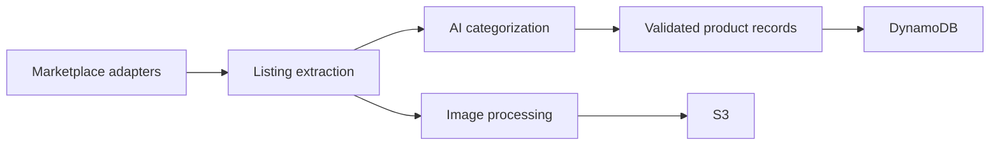
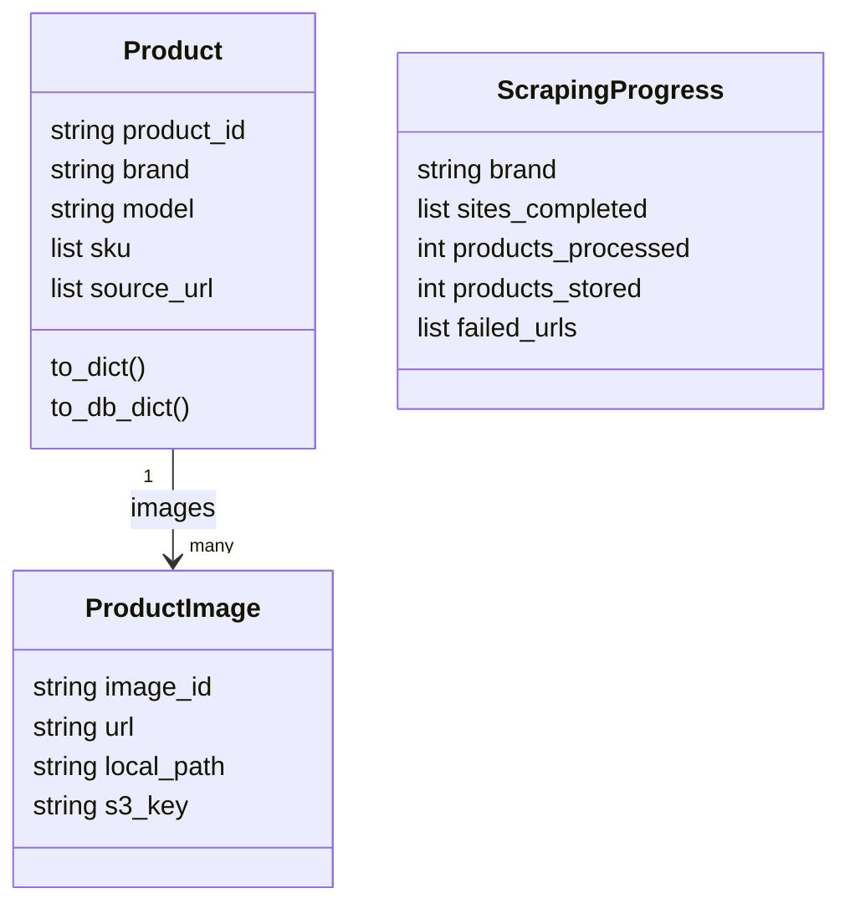

# Luxury Product Ingestion

**A Python pipeline that turns listings from multiple luxury resale sites into a structured product catalog.**

I built this as part of Auricore's pricing and product-data infrastructure. Comparing luxury goods across marketplaces requires collecting inconsistent listings, extracting useful attributes, handling product images, and saving a consistent record for downstream matching and valuation.

## What happens to a listing

1. A site-specific adapter retrieves and extracts the listing.
2. Categorization and parsing turn the source fields into a structured product record.
3. Image utilities handle the associated product imagery.
4. Storage code persists catalog records in DynamoDB and image objects in S3.
5. Progress and failure tracking help inspect an incomplete or interrupted run.

Collecting a listing and proving that it is the same product as another listing are separate tasks. This repository handles ingestion; the linked canonicalization project handles downstream matching and enrichment.

## Pipeline



The historical source includes adapters for The RealReal, Vestiaire Collective, Fashionphile, Farfetch, Rebag and StockX. Live site compatibility has not been revalidated. The implementation includes asynchronous scraping, rate limits, retries, progress tracking, Claude-based categorization, image handling and AWS storage.

| Area | Source |
| --- | --- |
| Multi-site CLI | [main.py](main.py) |
| Marketplace-specific extraction | [scraper/sites](scraper/sites) |
| Categorization | [ai_categorizer.py](scraper/utils/ai_categorizer.py) |
| Product and progress models | [data_models.py](scraper/utils/data_models.py) |
| Image handling | [optimized_image_handler.py](scraper/utils/optimized_image_handler.py) |
| Catalog and image storage | [optimized_aws_storage.py](optimized_aws_storage.py) |

## Data contracts and serialization

The pipeline uses Pydantic models to separate scraped fields from stored records. [Product](scraper/utils/data_models.py) contains `product_id`, brand, model, SKU values, category, product name, source URLs, and image objects. [ProductImage](scraper/utils/data_models.py) holds image identity and location metadata. `ScrapingProgress` records completed sites, found/processed/stored counts, failed URLs, and a timestamp.



Serialization is explicit. `Product.to_dict()` produces nested image records, while `to_db_dict()` serializes SKU and source-URL lists as JSON strings and retains image IDs. `ProductImage.to_dict()` does not emit its S3 fields, even though those fields exist on the model. Reading the serializer is therefore necessary before assuming every in-memory field reaches storage.

## Operational behavior

Site adapters isolate marketplace-specific extraction. Categorization, image handling, and AWS persistence sit in separate modules so a change in one site's markup does not need to redefine the product contract. Progress counters distinguish finding a listing from successfully storing it; failed URLs remain visible for inspection. This is useful operational structure, but it does not establish exactly-once ingestion or an atomic transaction across DynamoDB and S3.

## Try the data model offline

```sh
python3 -m venv .venv
source .venv/bin/activate
pip install 'pydantic>=2,<3'
python examples/offline_product.py
```

The example uses a synthetic product and exercises the actual validation and serialization models. It makes no network requests and requires no credentials.

## Configure the full pipeline

```sh
pip install -r requirements.txt
cp .env.example .env
# Supply your own API keys, supported model ID and isolated AWS resources.
python main.py
```

The full pipeline calls paid APIs and can create/write DynamoDB tables and S3 objects. Configure a dedicated development AWS profile and explicitly set `DYNAMODB_TABLE_NAME`, `FAILURES_TABLE_NAME` and `S3_BUCKET_NAME`. The public snapshot does not carry original credentials or fall back to the original storage resources.

This is historical source. Provider APIs, available model IDs and marketplace markup may have changed. The dependency file is not a reproducible lockfile; end-to-end ingestion has not been revalidated.

## Related work

[Product Canonicalization](https://github.com/Jaiashar/product-canonicalization) resolves and enriches product records downstream. [Auricore Web](https://github.com/Jaiashar/auricore-web) presents item identification and market-price research to users.

## Authorship and validation

See [PROVENANCE.md](PROVENANCE.md) for the original revision and publication changes. Source syntax and the synthetic offline example are checked; live scraping, AI calls and AWS writes are not part of this validation.
